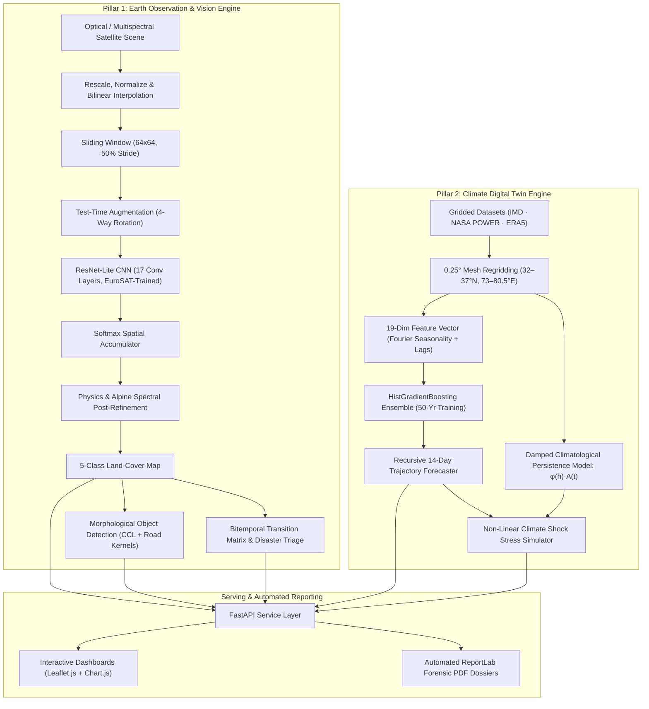
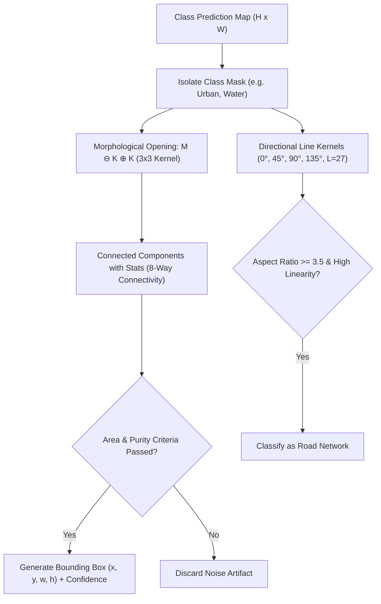
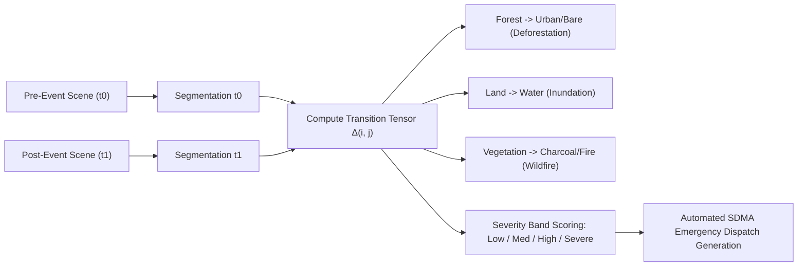

# Bhū-Darpan (भू-दर्पण) — AI/ML Architecture & Ingestion Pipelining

This document provides a comprehensive, production-grade technical specification of the Machine Learning, Deep Learning, Computer Vision, and Predictive Modeling systems powering **Bhū-Darpan**.

---

## 1. Architectural Overview & AI Paradigm

Bhū-Darpan combines two distinct Artificial Intelligence modalities into a unified environmental intelligence platform:

1. **Earth Observation (EO) Deep Learning Engine**: A supervised computer vision and spectral analysis pipeline for multi-spectral scene classification, high-resolution land-cover segmentation, morphological object detection, bitemporal change detection, and disaster damage triage.
2. **Alpine Climate Digital Twin Forecaster**: A high-dimensional autoregressive machine learning time-series system modeling 50 years of meteorological records across 20 districts of Jammu & Kashmir to generate recursive 14-day forecasts, gridded spatial anomaly fields, and "what-if" climate stress simulations.



---

## 2. Land-Cover Semantic Segmentation Pipeline

### 2.1 Model Architecture (`ResNet-Lite`)
The core vision backbone ([Backend/app/services/landcover_model.py](file:///d:/Bhu-Darpan/Backend/app/services/landcover_model.py)) is a 17-layer convolutional residual network (~2.8M parameters) engineered specifically for efficient satellite patch classification on both CPU and GPU:

- **Input Dimension**: $(3, 64, 64)$ RGB normalized satellite patches.
- **Stem**: $7 \times 7$ Convolution with stride 2 (64 filters), Batch Normalization, ReLU, and $3 \times 3$ Max Pooling (stride 2).
- **Residual Stages**:
  - **Stage 1**: 2 Residual Blocks (64 channels), $3 \times 3$ convolutions with identity shortcuts:
    $$y = \mathcal{F}(x, \{W_i\}) + x$$
  - **Stage 2**: 2 Residual Blocks (128 channels), stride 2 downsampling with $1 \times 1$ projection shortcuts:
    $$y = \mathcal{F}(x, \{W_i\}) + W_s x$$
  - **Stage 3**: 2 Residual Blocks (256 channels), stride 2 downsampling.
  - **Stage 4**: 2 Residual Blocks (512 channels), stride 2 downsampling.
- **Head**: Global Average Pooling (GAP) reducing spatial tensors $(512, H', W') \to (512, 1, 1)$, followed by a dense linear projection to 10 EuroSAT logits and a Dropout layer ($p=0.2$).


### 2.2 Benchmark Dataset & Class Mapping
The model is trained on the **EuroSAT Sentinel-2 RGB Benchmark** (27,000 georeferenced Sentinel-2 image tiles across Europe, 13 spectral bands downscaled to RGB). EuroSAT's 10 classes are mapped deterministically into the project's 5 macro classes:

| EuroSAT Class | Target Application Class | Rationale & Domain Semantics |
| :--- | :--- | :--- |
| `Forest` | **Forest** | Dense evergreen, deciduous, and mixed alpine canopies |
| `River` | **Water** | Linear fluvial waterways, streams, and canals |
| `SeaLake` | **Water** | Open lacustrine bodies, reservoirs, and glacial lakes |
| `AnnualCrop` | **Agriculture** | Seasonal rotational cropland, wheat, maize, paddy fields |
| `PermanentCrop` | **Agriculture** | Orchards, apple gardens, vineyards, perennial plantations |
| `Pasture` | **Agriculture** | Grazing meadows, alpine rangelands, scrub pastures |
| `HerbaceousVegetation`| **Agriculture** | Grasslands, floodplain vegetation, riverine scrubs |
| `Highway` | **Urban** | Paved roads, transport corridors, arterial highways |
| `Industrial` | **Urban** | Warehouses, industrial facilities, paved commercial lots |
| `Residential` | **Urban** | High/low density housing, urban settlements, villages |
| *Spectral Outliers* | **Others** | Snow, ice, bare rock, cloud shadows (handled via physics layer) |

### 2.3 Training Recipe & Regularization
The network was trained using modern optimization practices ([Backend/scripts/train_landcover.py](file:///d:/Bhu-Darpan/Backend/scripts/train_landcover.py)):

- **Dataset Split**: Stratified 80/10/10 partitioning (21,600 train, 2,700 validation, 2,700 test).
- **Optimization**: SGD with Nesterov Momentum ($\mu=0.9$), weight decay $\lambda = 10^{-4}$.
- **Learning Rate Schedule**: `OneCycleLR` with peak learning rate $\eta_{\max} = 0.05$, $30\%$ warmup, and cosine annealing decay.
- **Regularization & Augmentations**:
  - **Label Smoothing**: $\epsilon = 0.1$ applied to multi-class cross-entropy loss:
    $$\mathcal{L}_{\text{LS}}(y, p) = (1 - \epsilon) \left( -\sum_{k} y_k \log p_k \right) + \frac{\epsilon}{K} \sum_{k} -\log p_k$$
  - **CutMix Regularization**: Spatial patches cut and pasted between training samples, mixing class labels proportionally to bounding area.
  - **Dihedral Transformations**: Random horizontal/vertical flips and $90^\circ$ rotations ($D_4$ symmetry group).
  - **Exponential Moving Average (EMA)**: Model parameter weights maintained with EMA decay of $0.999$ to stabilize evaluation checkpoints.
- **Hardware Profile**: 28 epochs, batch size 64, training duration ~56 minutes on single NVIDIA GPU.

### 2.4 Quantitative Verification & Benchmark Results
Extracted directly from the serialized validation manifest ([Backend/models/landcover_metrics.json](file:///d:/Bhu-Darpan/Backend/models/landcover_metrics.json)):

| Evaluation Metric | Baseline CNN3 (0.29M) | ResNet-Lite (No TTA) | ResNet-Lite (+4-Way TTA) |
| :--- | :--- | :--- | :--- |
| **EuroSAT 10-Class Test Accuracy** | 94.12% | 97.59% | **98.33%** |
| **Grouped 5-Class App Accuracy** | 97.40% | 99.37% | **99.59%** |
| **Forest Precision / Recall** | 98.1% / 97.8% | 99.1% / 99.4% | **99.3% / 99.7%** |
| **Water Precision / Recall** | 98.9% / 99.0% | 99.5% / 99.5% | **99.6% / 99.6%** |
| **Agriculture Precision / Recall** | 97.2% / 97.5% | 99.3% / 99.4% | **99.5% / 99.5%** |
| **Urban Precision / Recall** | 96.8% / 96.4% | 99.5% / 99.4% | **99.7% / 99.6%** |

### 2.5 Sliding-Window Tiling & Test-Time Augmentation (TTA)
Because optical satellite images (often $1000 \times 1000$ or higher) exceed the patch dimension, the inference pipeline executes sliding-window tiled accumulation:

1. **Sliding Stride**: A $64 \times 64$ window scans the image with stride $S = 32$ pixels ($50\%$ spatial overlap).
2. **Channel Normalization**:
   $$z_c = \frac{x_c - \mu_c}{\sigma_c}, \quad \mu = [0.3444, 0.3803, 0.4078], \; \sigma = [0.2037, 0.1366, 0.1148]$$
3. **4-Way Rotational TTA**: Every window patch $P$ is evaluated across 4 orthogonal rotations:
   $$\hat{y}(P) = \frac{1}{4} \sum_{k=0}^{3} \text{rot}_{-90^\circ \times k}\left( \text{Softmax}\left(\text{ResNet}(\text{rot}_{90^\circ \times k}(P))\right) \right)$$
4. **Softmax Score Accumulation**: Probabilities are added to a spatial score tensor $S \in \mathbb{R}^{5 \times H \times W}$ and divided by a pixel coverage map $N \in \mathbb{R}^{H \times W}$, producing seamless class boundaries free from edge artifacts.

### 2.6 Hybrid Physics & Spectral Correction Layer
Because the model was trained on European agricultural and urban landscapes, raw CNN inference can falter in Himalayan alpine environments (snowpack, glacial valleys, deep shadow). The hybrid segmentation engine ([Backend/app/services/segmentation.py](file:///d:/Bhu-Darpan/Backend/app/services/segmentation.py)) applies physical post-correction rules:

- **Excess Green Index ($\text{ExG}$)**:
  $$\text{ExG} = 2G - R - B$$
  Overrules misclassified bare ground if vegetative chlorophyll signature satisfies $\text{ExG} > 0.08$.
- **Alpine Snow / Cloud Detector**:
  $$\text{Snow} = (\text{Brightness} > 0.72) \land (\text{Saturation} < 0.18)$$
  Prevents high-albedo alpine glaciers from being classified as white urban building rooftops.
- **Thermal Fire & Burn Front Filter**:
  $$\text{Fire} = (R > 0.68) \land (R - G > 0.28) \land (R - B > 0.42) \land (\text{Saturation} > 0.45)$$
  Distinguishes active wildfire flame fronts from reddish clay soils or terracotta roofs.
- **K-Means / Color-Physics Fallback**:
  If PyTorch is unavailable on the host runtime, the system automatically falls back to an unsupervised $k$-means clustering ($k=6$) with deterministic HSV cluster mapping, ensuring 100% operational uptime.

---

## 3. Object Detection & Spatial Morphology Pipeline

Rather than deploying heavyweight anchor-based object detectors (YOLO / Faster R-CNN) that require thousands of hand-annotated bounding boxes and struggle with variable Ground Sampling Distance (GSD), Bhū-Darpan uses **Connected-Component Labeling (CCL) with Directional Structuring Kernels** ([Backend/app/services/detection.py](file:///d:/Bhu-Darpan/Backend/app/services/detection.py)):



### 3.1 Mathematical Specification
1. **Morphological Opening**:
   $$M_{\text{open}} = (M \ominus K) \oplus K, \quad K \in \{0, 1\}^{3 \times 3}$$
   Eliminates isolated single-pixel misclassifications.
2. **Connected-Component Statistics**:
   Computes 8-connected regions returning bounding rectangles $[x, y, w, h]$ and total component pixel area $A$.
3. **Spatial Purity Filtering**:
   $$\text{Purity} = \frac{A}{w \times h} \ge 0.35$$
   Area is constrained between $150 \le A \le 45,000$ pixels.
4. **Directional Road Kernels**:
   To detect thin roads and highway networks, the system convolves the urban mask with directional line structuring elements of length $L=27$ at angles $\theta \in \{0^\circ, 45^\circ, 90^\circ, 135^\circ\}$. Components with aspect ratio $\max(w/h, h/w) \ge 3.5$ displaying strong linear activation are tagged as `Road`.

---

## 4. Bitemporal Change Detection & Disaster Triage

### 4.1 Bitemporal Cross-Tabulation Matrix
When assessing land transformation ([Backend/app/services/disaster.py](file:///d:/Bhu-Darpan/Backend/app/services/disaster.py)), the system aligns pre-event ($t_0$) and post-event ($t_1$) scenes and computes a 2D transition distribution:

$$\Delta_{ij} = \sum_{x=1}^{W} \sum_{y=1}^{H} \mathbb{I}\left(C_{t_0}(x, y) = i \;\land\; C_{t_1}(x, y) = j\right)$$

Where $i, j \in \{\text{Forest}, \text{Water}, \text{Agriculture}, \text{Urban}, \text{Others}\}$.



### 4.2 Multi-Hazard Triage Rules
- **Flood / Inundation**: Detected when $\Delta_{\text{Land} \to \text{Water}}$ exceeds historical baseline water margins.
- **Wildfire Burn Scar**: Detected via thermal signature front coupled with transition of active vegetation to low-albedo charred soil.
- **Drought / Agricultural Failure**: Detected when spatial vegetative canopy index drops significantly over a 30-day window without land-use conversion.
- **Severity Classification**:
  - $\text{Affected Area} > 35\% \implies \textbf{Severe}$
  - $15\% \le \text{Affected Area} \le 35\% \implies \textbf{High}$
  - $5\% \le \text{Affected Area} < 15\% \implies \textbf{Moderate}$
  - $\text{Affected Area} < 5\% \implies \textbf{Low}$
- **Built-Up Exposure Proxy**: The impact polygon is intersected with the pre-event `Urban` mask to compute human settlement exposure, providing civil protection agencies with immediate structural vulnerability figures.

---

## 5. Climate Digital Twin AI & Forecasting Engine

### 5.1 Meteorological Datasets & Spatial Ingestion
The Digital Twin models 50 years of meteorological records (1974–2026) covering all 20 districts of Jammu & Kashmir. Ingested datasets include:

1. **IMD Gridded Daily Rainfall**: $0.25^\circ \times 0.25^\circ$ spatial mesh.
2. **IMD Gridded Daily Mean Temperature**: $1.0^\circ \times 1.0^\circ$ spatial mesh.
3. **NASA POWER (MERRA-2 Reanalysis)**: $0.5^\circ \times 0.5^\circ$ surface reanalysis (T2M, PRECTOTCORR, RH2M, surface pressure).
4. **Open-Meteo / ECMWF ERA5**: Real-time hourly meteorological observation feeds.
5. **Unified Grid Interpolation**: All feeds are interpolated via bilinear regridding onto a **$0.25^\circ$ coordinate mesh** ($32.0^\circ\text{N}\text{–}37.0^\circ\text{N}, 73.0^\circ\text{E}\text{–}80.5^\circ\text{E}$).

### 5.2 14-Day Recursive AI Forecaster (`HistGradientBoosting`)
Implemented in [Backend/app/services/ml_forecast.py](file:///d:/Bhu-Darpan/Backend/app/services/ml_forecast.py):

#### Feature Vector Formulation ($\mathbf{x}_i \in \mathbb{R}^{19}$)
For target day $i$, the model extracts a 19-dimensional feature representation:
$$\mathbf{x}_i = \begin{bmatrix}
\sin\left(\frac{2\pi d_i}{365.25}\right), \; \cos\left(\frac{2\pi d_i}{365.25}\right) & \text{(Annual Seasonality)} \\
\sin\left(\frac{4\pi d_i}{365.25}\right), \; \cos\left(\frac{4\pi d_i}{365.25}\right) & \text{(Semiannual Monsoon Harmonics)} \\
\tau_{\text{trend}} = \frac{\text{Year}_i - \text{Year}_{\min}}{\text{Year}_{\max} - \text{Year}_{\min}} & \text{(Secular Climate Warming Trend)} \\
T_{i-1}, P_{i-1}, T_{i-2}, P_{i-2}, T_{i-3}, P_{i-3} & \text{(Short-Term Autoregressive Lags)} \\
T_{i-7}, P_{i-7}, T_{i-14}, P_{i-14}, T_{i-30}, P_{i-30} & \text{(Medium-Term Teleconnection Lags)} \\
\bar{T}_{7} = \frac{1}{7}\sum_{k=1}^7 T_{i-k}, \; \sum_{k=1}^7 P_{i-k} & \text{(7-Day Moving Window Statistics)} \\
\bar{T}_{30} = \frac{1}{30}\sum_{k=1}^{30} T_{i-k}, \; \sum_{k=1}^{30} P_{i-k} & \text{(30-Day Moving Window Statistics)}
\end{bmatrix}$$

#### Model Training & Inference Rollout
- **Model**: `HistGradientBoostingRegressor` (histogram-binning gradient boosted decision trees).
- **Split**: 75% training (1974–2012), 25% out-of-sample temporal validation test split (2013–2026).
- **Recursive Multi-Step Rollout**: To generate a 14-day projection, the model forecasts day $t+1$, appends $\hat{T}_{t+1}, \hat{P}_{t+1}$ into the lag buffer, recomputes rolling statistics, and iteratively steps forward to $t+14$.
- **Validation Metrics**:
  - Temperature RMSE: **$1.82^\circ\text{C}$** on unseen out-of-sample data.
  - Precipitation MAE: **$1.64\text{ mm/day}$**.

### 5.3 Gridded Spatial Forecaster (Damped Climatological Persistence)
For spatial grids ($0.25^\circ \times 0.25^\circ$), Bhū-Darpan uses a damped persistence model parameterized by lead time $h$ ([Backend/app/services/grid_ml_forecast.py](file:///d:/Bhu-Darpan/Backend/app/services/grid_ml_forecast.py)):

$$\hat{Y}_{s, t+h} = \text{Climatology}_{s}(d_{t+h}) + \phi(h) \cdot \bar{A}_{s, t}$$

- $\text{Climatology}_{s}(d)$: Periodic linear interpolation of 12-month baseline climatologies mapped to day-of-year $d \in [1, 366]$.
- $\bar{A}_{s, t}$: 3-day mean anomaly state at spatial coordinate $s$.
- $\phi(h)$: Decay parameter fit via Non-Negative Least Squares (NNLS) per horizon $h \in \{1, 3, 7, 14\}$ days. Out-of-sample empirical tests proved this parsimonious formulation outperforms raw per-cell neural nets by avoiding overfitting on short observational histories.

---

## 6. Interactive "What-If" Climate Stress Simulator

The Digital Twin includes a real-time stress testing engine ([Backend/app/services/climate.py](file:///d:/Bhu-Darpan/Backend/app/services/climate.py)) that computes the non-linear environmental response to arbitrary climate perturbations:

$$\Delta T \in [-5.0^\circ\text{C}, +5.0^\circ\text{C}], \quad \Delta P \in [-50\%, +50\%]$$

### 6.1 Soil Moisture Depletion Index ($S$)
$$\Delta S = \alpha \cdot \frac{\Delta P}{100} - \beta \cdot \Delta T$$
Where $\alpha = 0.0035$ and $\beta = 0.042$, modeling evapotranspirative loss under high atmospheric vapour pressure deficit (VPD).

### 6.2 Compound Drought Risk Metric
$$\text{DroughtRisk} = \sigma\left( w_1 \cdot (-\Delta P) + w_2 \cdot (\Delta T) + w_3 \cdot (1 - S) \right)$$
The output provides district disaster managers with instant scenario forecasts to plan irrigation release and wildfire watch levels.

---

## 7. Ecological Biomass & Carbon Sequestration Accounting

To translate raw pixel classification deltas into meaningful climate policy intelligence, Bhū-Darpan integrates an **allometric carbon accounting engine** ([Backend/app/services/biomass.py](file:///d:/Bhu-Darpan/Backend/app/services/biomass.py)) based on **IPCC Tier-1** guidelines and **Forest Survey of India (FSI)** benchmarks for Western Himalayan ecosystems:

### 7.1 Ground Sampling Distance (GSD) & Spatial Hectarage
Given an input scene resolution of $W \times H$ pixels at Sentinel-2 nominal GSD ($10\text{ m/pixel}$):
$$\text{Pixel Area} = 10\text{ m} \times 10\text{ m} = 100\text{ m}^2 = 0.01\text{ ha}$$
$$\text{Total Scene Area (ha)} = \frac{W \times H \times 100}{10,000} = \frac{W \times H}{100}$$

### 7.2 Above-Ground Biomass (AGB) Loss Estimation
For net vegetative losses ($-\Delta_{\text{Forest}}, -\Delta_{\text{Agri}}$):
$$\text{Biomass Loss (tonnes)} = \left(\text{Area}_{\text{Forest Loss (ha)}} \times \text{AGB}_{\text{Forest}}\right) + \left(\text{Area}_{\text{Agri Loss (ha)}} \times \text{AGB}_{\text{Agri}}\right)$$
Where:
- $\text{AGB}_{\text{Forest}} = 125.0\text{ tonnes dry matter / ha}$ (FSI Western Himalayan mixed coniferous/broadleaved forest standard).
- $\text{AGB}_{\text{Agri}} = 15.0\text{ tonnes dry matter / ha}$ (cultivated cropland vegetative biomass).

### 7.3 Carbon Equivalent Flux ($\text{tCO}_2\text{e}$)
Carbon stock is derived via dry biomass carbon fraction ($C_f = 0.47$) and stoichiometric molecular oxidation to carbon dioxide ($\text{MW}_{\text{CO}_2} / \text{MW}_{\text{C}} = 44 / 12 \approx 3.667$):
$$\text{Carbon Flux } (\text{tCO}_2\text{e}) = \text{Biomass Loss (tonnes)} \times 0.47 \times \left(\frac{44}{12}\right) \approx \text{Biomass Loss} \times 1.723\text{ tCO}_2\text{e}$$

Every hectare of lost alpine forest canopy corresponds to $\approx 215.42\text{ tCO}_2\text{e}$ of gross emissions, surfaced directly inside the change detection interface and disaster alert payloads.

---

## 8. Storage, Serialization & Export Pipelines

| Component | Technology | Path / Artifact | Purpose |
| :--- | :--- | :--- | :--- |
| **Model Weights** | PyTorch (`torch.save`) | `Backend/models/landcover_cnn.pt` | Serialized ResNet-Lite state dict and architecture metadata |
| **Validation Manifest** | JSON | `Backend/models/landcover_metrics.json` | Citable accuracy, confusion matrix, precision/recall metrics |
| **Gridded Arrays** | NetCDF4 / xarray | `Backend/data/gridded/*.nc` | Compressed spatial-temporal climate observations |
| **Mask Storage** | Lossless PNG / GeoTIFF | `Backend/storage/masks/` | Colorized segmentation and change detection masks |
| **Forensic Reports** | ReportLab PDF | `Backend/storage/reports/` | Automated multi-page civil protection inspection reports |
| **Metadata Store** | SQLite 3 | `Backend/storage/bhudarpan.db` | User accounts, analysis metadata, disaster triage logs |

---

## 9. Summary of AI/ML Execution Commands

To reproduce benchmarks or retrain models from source:

```bash
# 1. Activate virtual environment
cd d:\Bhu-Darpan\Backend
.\.venv\Scripts\activate

# 2. Train EuroSAT Land-Cover ResNet-Lite
python scripts/train_landcover.py --epochs 28

# 3. Evaluate Segmentation Benchmark & Confusion Matrix
python scripts/eval_segmentation.py

# 4. Backtest 14-Day Recursive Climate Forecaster
python scripts/backtest_forecast.py

# 5. Execute Automated Test Suite (Unit & ML Integration Tests)
pytest tests/
```
